# ProvaTrack

Sistema web para gerenciamento de provas de ciclismo e atletismo: atletas, equipes, provas e resultados em um só lugar.

Projeto da disciplina de Desenvolvimento de Sistemas Web, IFRN, Campus Pau dos Ferros.

## Ideia do projeto

Organizar uma prova esportiva costuma envolver planilhas e mensagens soltas: quem está inscrito, de qual equipe, quanto tempo fez e quem ganhou. O ProvaTrack centraliza essas informações em um único sistema, para cadastrar atletas e equipes, criar provas, registrar os resultados e consultar o ranking geral.

## Escopo

**O sistema faz:**
- Cadastro, listagem, edição e exclusão de atletas
- Cadastro, listagem, edição e exclusão de equipes
- Cadastro e listagem de provas, com filtro por modalidade e página de detalhes
- Registro de resultados por prova (posição, tempo e pontos)
- Ranking geral dos atletas por pontos
- Login de usuários

**O sistema não faz (fora do escopo):**
- Inscrição online de atletas pelo público
- Pagamentos e taxas de inscrição
- Cronometragem em tempo real

## Entidades

| Entidade | Descrição | Principais campos |
|---|---|---|
| Equipe | Grupo ao qual os atletas pertencem | nome, sigla, cidade, uf, modalidade |
| Atleta | Participante das provas | nome, data de nascimento, sexo, cidade, modalidade, equipe |
| Prova | Competição de ciclismo ou atletismo | nome, modalidade, data, local, distância, status |
| Resultado | Desempenho de um atleta em uma prova | atleta, prova, posição, tempo, pontos |

Relacionamentos: uma equipe tem vários atletas, e um atleta tem vários resultados. Uma prova gera vários resultados, um por atleta. Detalhes e diagrama em [docs/entidades.md](docs/entidades.md).

## Protótipos

Telas prototipadas do sistema, todas no mesmo layout base (paleta, fonte Inter, navbar e rodapé, descritos em [docs/layout-base.md](docs/layout-base.md)). As imagens e o código HTML de cada tela ficam em [docs/prototipos/](docs/prototipos/).

### Layout base


Código: [navbar-rodape.html](docs/prototipos/navbar-rodape.html)

### Login e início

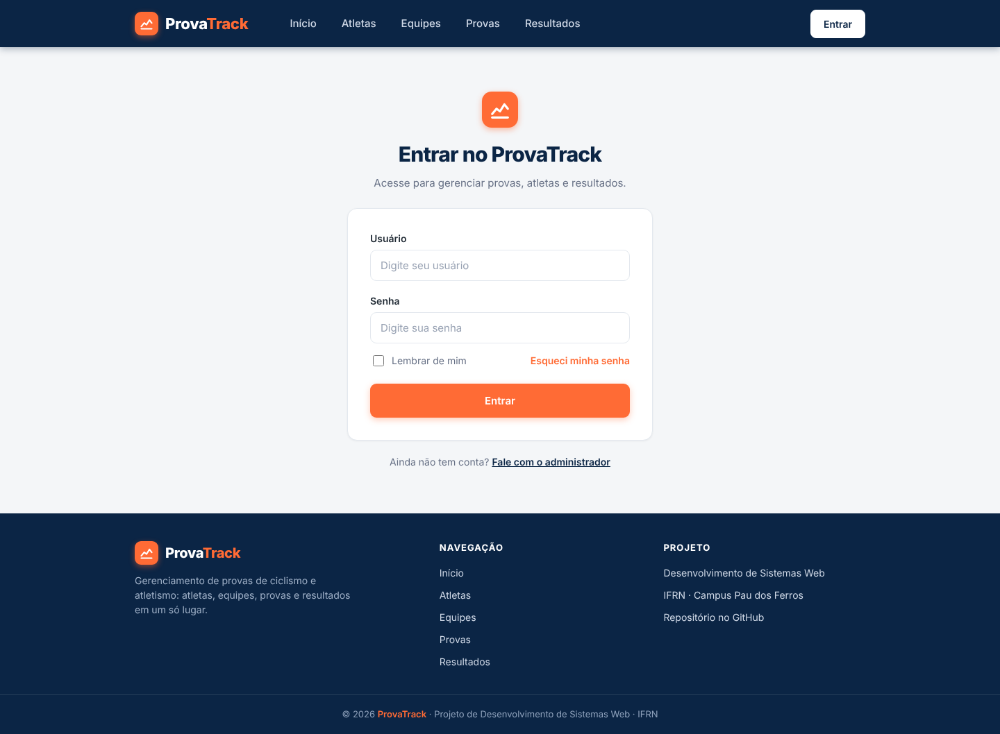

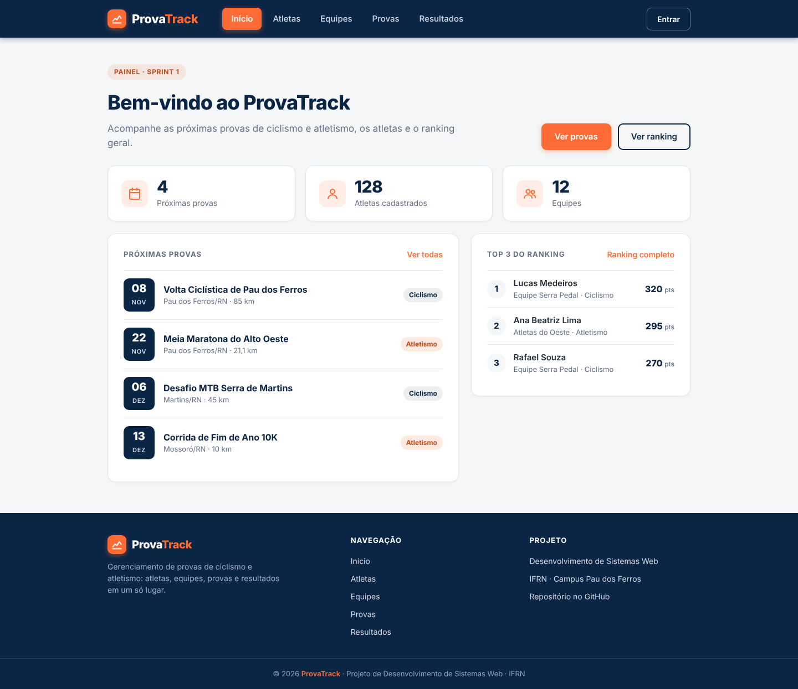

Código: [login.html](docs/prototipos/login.html) · [home.html](docs/prototipos/home.html)

### Atletas e equipes

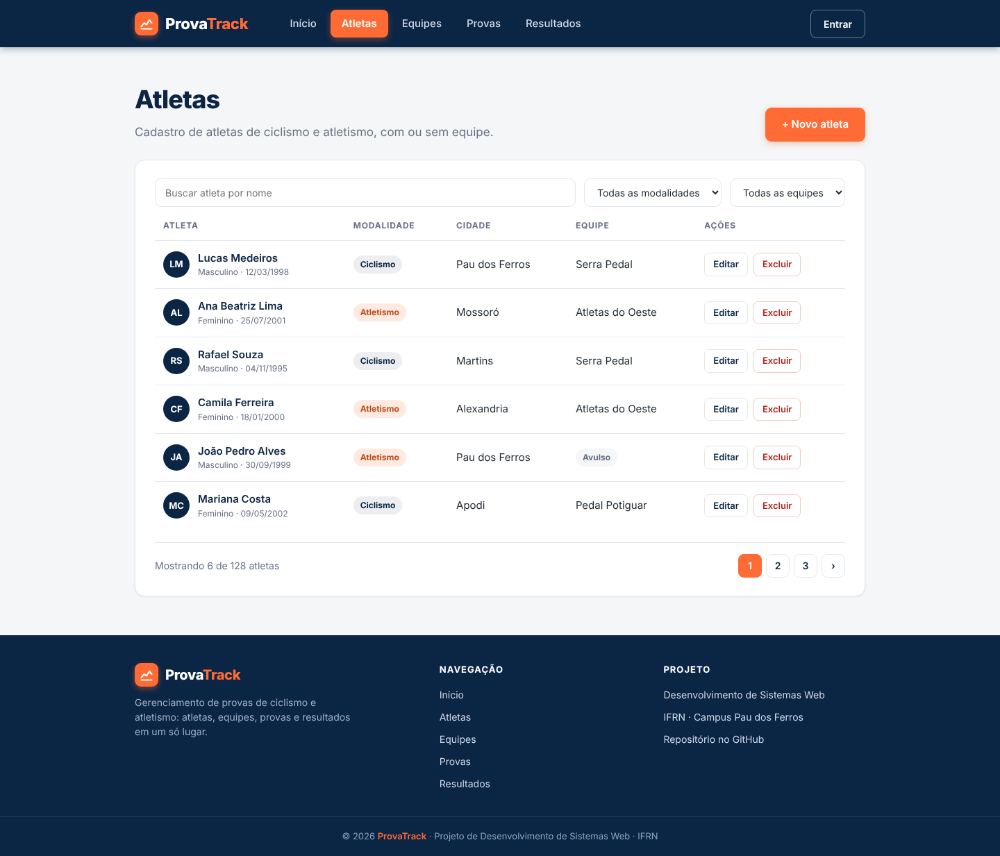

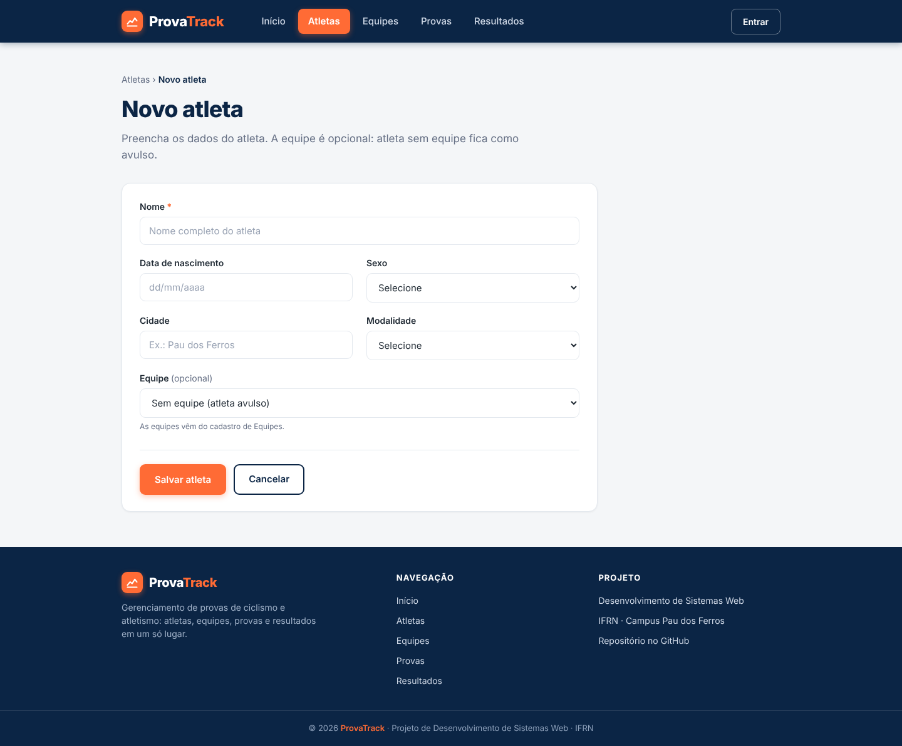

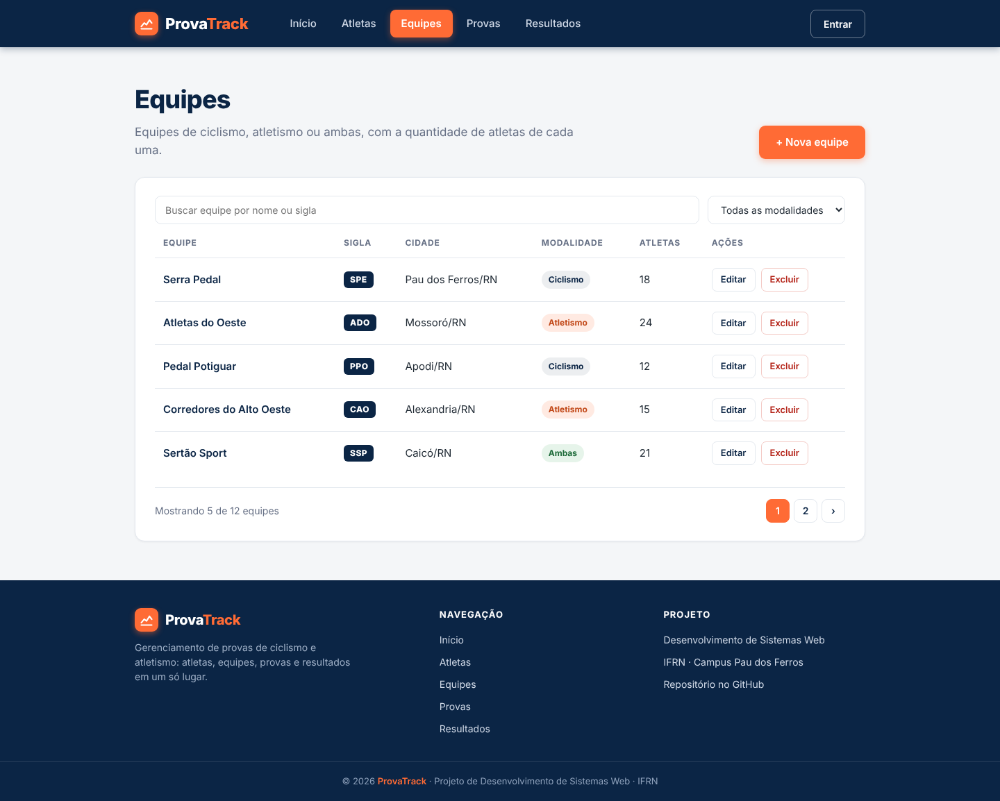

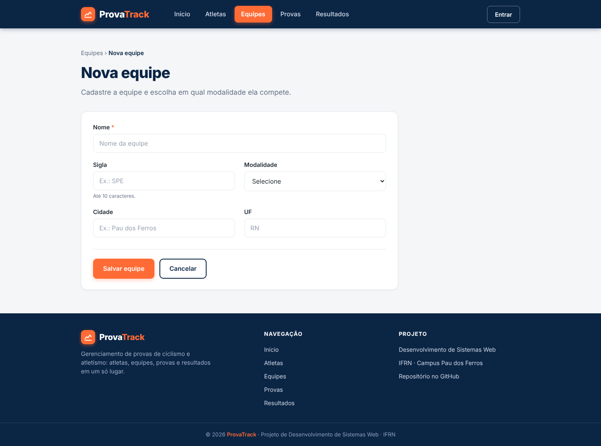

Código: [atletas-lista.html](docs/prototipos/atletas-lista.html) · [atletas-formulario.html](docs/prototipos/atletas-formulario.html) · [equipes-lista.html](docs/prototipos/equipes-lista.html) · [equipes-formulario.html](docs/prototipos/equipes-formulario.html)

### Provas

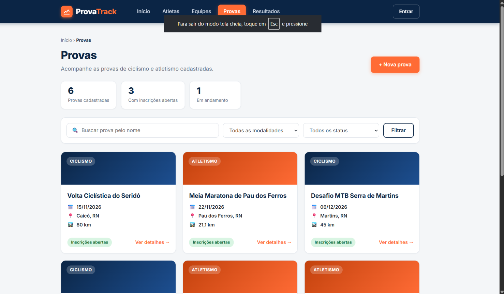

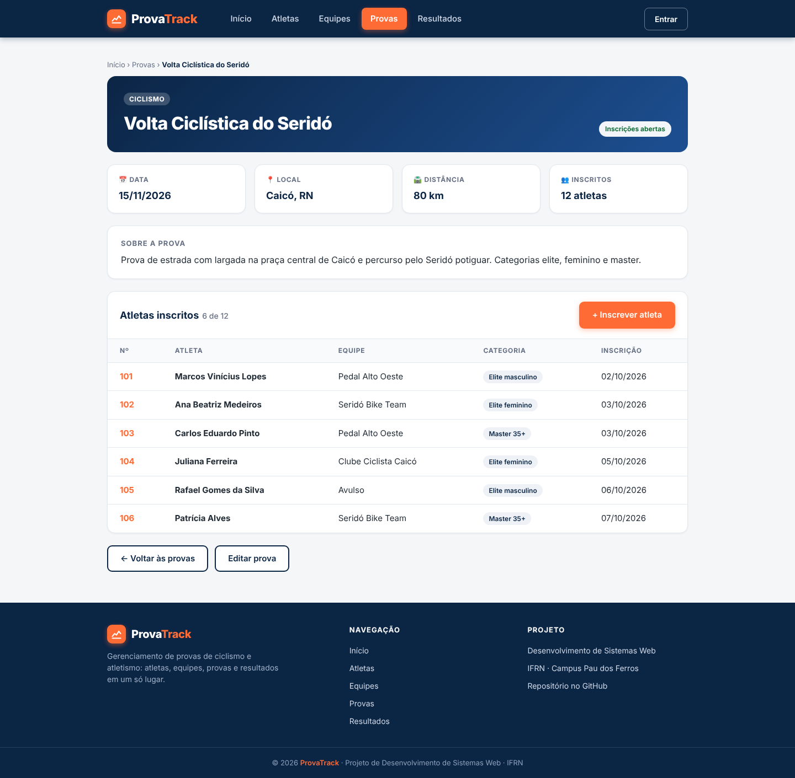

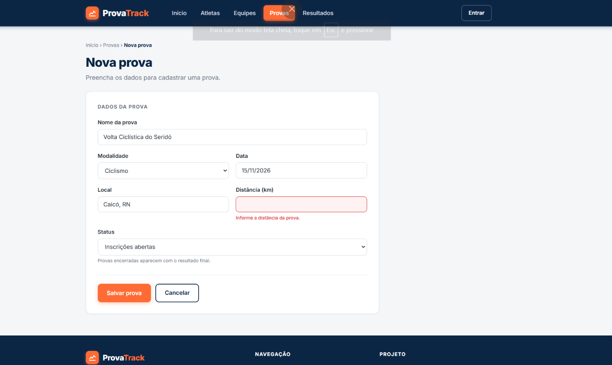

Código: [provas-lista.html](docs/prototipos/provas-lista.html) · [provas-detalhe.html](docs/prototipos/provas-detalhe.html) · [provas-formulario.html](docs/prototipos/provas-formulario.html)

### Resultados e ranking

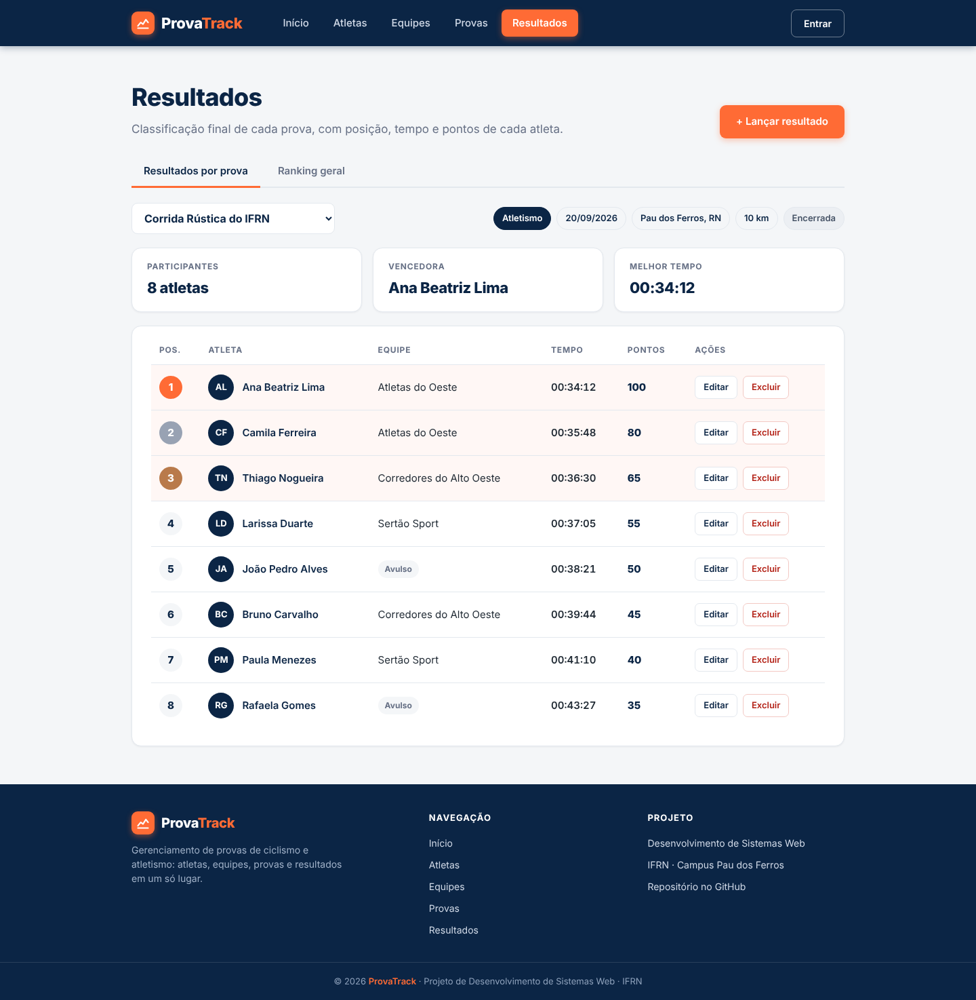

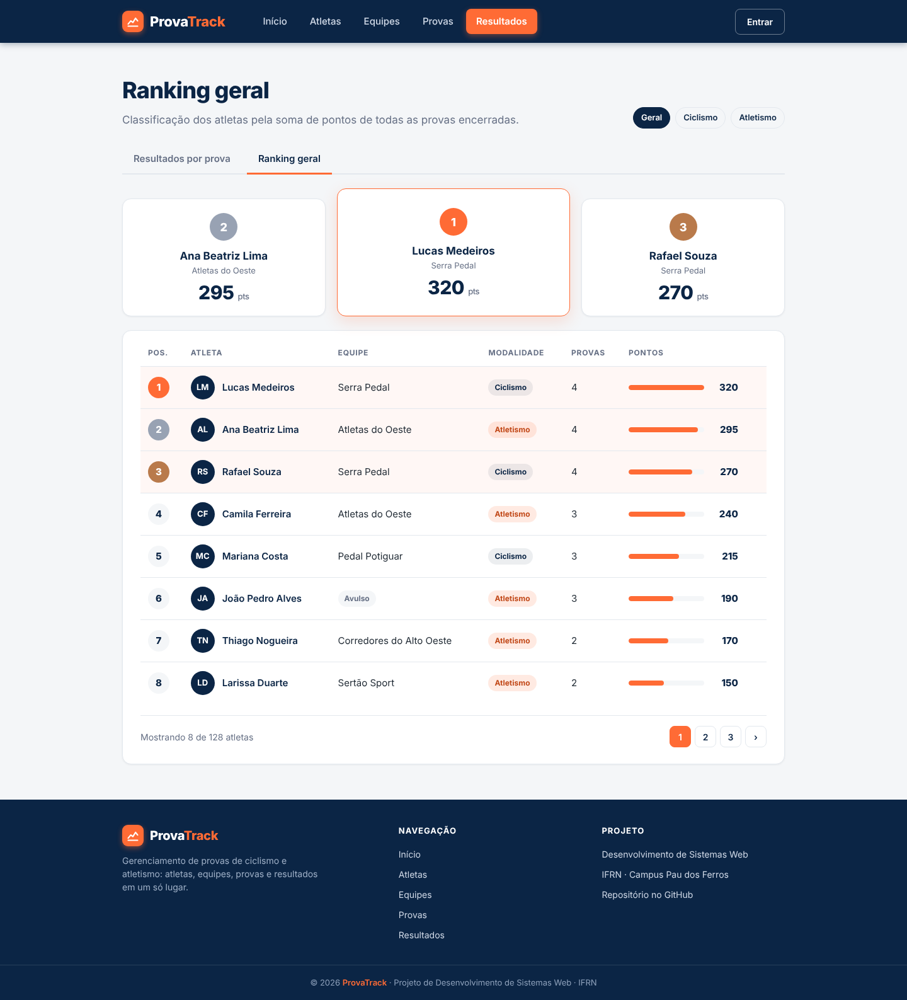

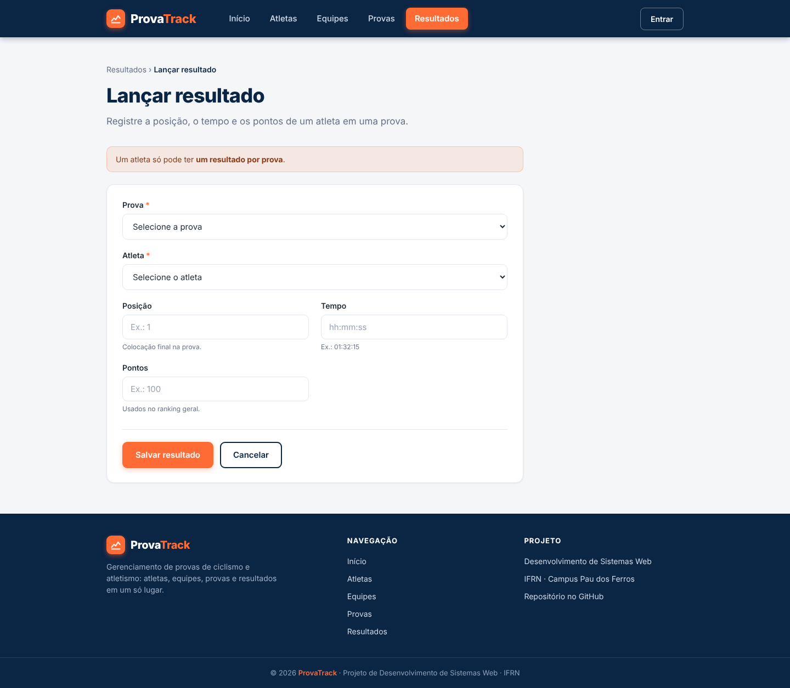

Código: [resultados-lista.html](docs/prototipos/resultados-lista.html) · [ranking-geral.html](docs/prototipos/ranking-geral.html) · [resultados-formulario.html](docs/prototipos/resultados-formulario.html)

## Tecnologias

- Python e Django
- HTML e CSS
- Git e GitHub (issues, board, pull requests)

## Equipe

- Samuel Oliveira
- Victor Gabriel 

## Como executar

```bash
git clone https://github.com/provatrack-dev/provatrack.git
cd provatrack
python -m venv venv
venv\Scripts\activate
pip install -r requirements.txt
python manage.py runserver
```

Depois acesse http://127.0.0.1:8000/