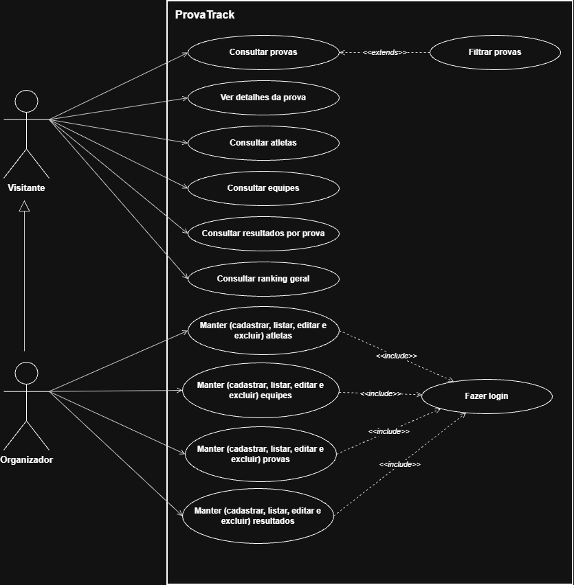

# Casos de uso do ProvaTrack

Os casos de uso mostram o que o sistema oferece a cada tipo de usuário, sem detalhar como é feito por dentro. Cada caso de uso atende a requisitos do [documento de requisitos](requisitos.md).

## 1. Diagrama

O retângulo é a fronteira do sistema (ProvaTrack). Os atores ficam fora dele.

**Como ler:**
- **Organizador herda de Visitante** (seta com triângulo vazado): ele faz tudo que o Visitante faz e mais o cadastro de dados.
- **«include»** (obrigatório): para manter qualquer cadastro, o Organizador precisa fazer login.
- **«extend»** (opcional): filtrar é uma opção de quem consulta as provas.
- "Manter" quer dizer cadastrar, listar, editar e excluir.

## 2. Atores

| Ator | Descrição |
|---|---|
| Visitante | Pessoa sem login que consulta provas, atletas, equipes, resultados e ranking. |
| Organizador | Pessoa com login que organiza as provas. Faz tudo que o Visitante faz e também mantém atletas, equipes, provas e resultados. |

## 3. Lista de casos de uso

| ID | Caso de uso | Ator | Requisitos |
|---|---|---|---|
| UC01 | Fazer login | Organizador | RF01, RN06 |
| UC02 | Consultar provas | Visitante | RF08 |
| UC03 | Ver detalhes da prova | Visitante | RF09 |
| UC04 | Consultar atletas | Visitante | RF06 |
| UC05 | Consultar equipes | Visitante | RF07 |
| UC06 | Consultar resultados por prova | Visitante | RF10 |
| UC07 | Consultar ranking geral | Visitante | RF11, RN05 |
| UC08 | Manter atletas | Organizador | RF02, RF12, RN02 |
| UC09 | Manter equipes | Organizador | RF03, RF12, RN03 |
| UC10 | Manter provas | Organizador | RF04, RF12 |
| UC11 | Manter resultados | Organizador | RF05, RF12, RN01, RN04 |
| UC12 | Filtrar provas (opcional ao consultar provas) | Visitante | RF08 |

