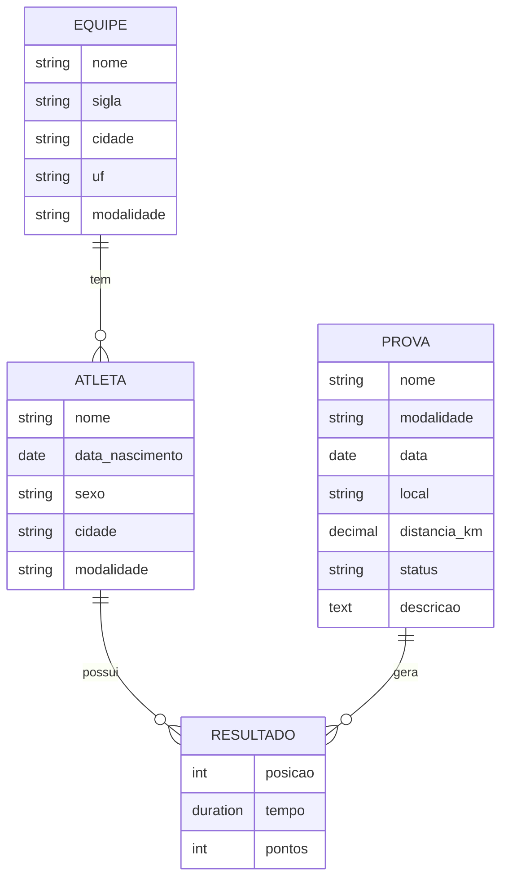

# Entidades e campos do ProvaTrack

## Visão geral

O sistema gerencia provas de ciclismo e atletismo. Tem 4 entidades principais:
Equipe, Atleta, Prova e Resultado.

## 1. Equipe

| Campo | Tipo | Observação |
|---|---|---|
| nome | Texto (100) | Obrigatório |
| sigla | Texto (10) | Ex.: SPE |
| cidade | Texto (100) | |
| uf | Texto (2) | Ex.: RN |
| modalidade | Escolha | Ciclismo, Atletismo ou Ambas |

## 2. Atleta

| Campo | Tipo | Observação |
|---|---|---|
| nome | Texto (150) | Obrigatório |
| data_nascimento | Data | |
| sexo | Escolha | Masculino ou Feminino |
| cidade | Texto (100) | |
| modalidade | Escolha | Ciclismo ou Atletismo |
| equipe | Chave estrangeira (Equipe) | Opcional, pode ser atleta avulso |

## 3. Prova

| Campo | Tipo | Observação |
|---|---|---|
| nome | Texto (150) | Obrigatório |
| modalidade | Escolha | Ciclismo ou Atletismo |
| data | Data | |
| local | Texto (150) | |
| distancia_km | Decimal | Ex.: 42.2 |
| status | Escolha | Aberta, Em andamento ou Encerrada |
| descricao | Texto longo | Opcional. Resumo da prova (percurso, categorias) |

## 4. Resultado

| Campo | Tipo | Observação |
|---|---|---|
| atleta | Chave estrangeira (Atleta) | Obrigatório |
| prova | Chave estrangeira (Prova) | Obrigatório |
| posicao | Número inteiro | Colocação final |
| tempo | Duração | Ex.: 01:32:15 |
| pontos | Número inteiro | Para o ranking |

Regra: um atleta só pode ter um resultado por prova.

## Relacionamentos

- **Atleta pertence a Equipe** (N para 1): uma equipe tem vários atletas, e cada atleta pertence a no máximo uma equipe.
- **Resultado pertence a Atleta** (N para 1): um atleta pode ter vários resultados.
- **Resultado pertence a Prova** (N para 1): uma prova gera vários resultados, um por atleta participante.
- **Atleta e Prova** (N para N): a tabela Resultado faz essa ligação e guarda posição, tempo e pontos.

## Diagrama

## Observação sobre o login

O login (tela da issue #3) usará o sistema de usuários que o Django já traz pronto, sem entidade extra.