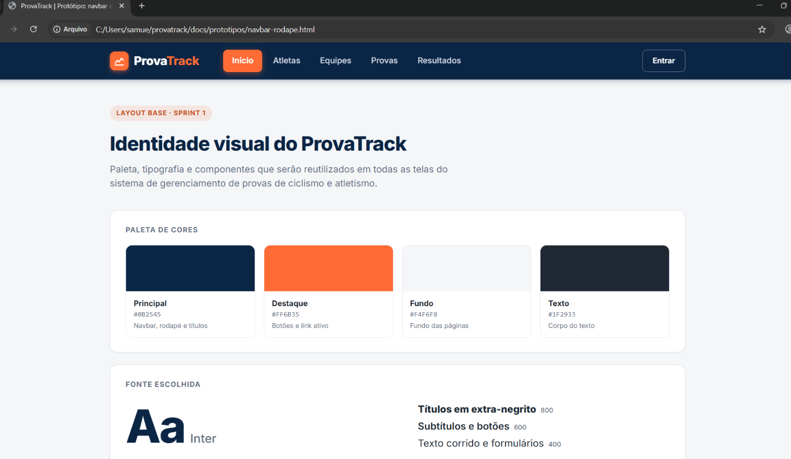

# Layout base do ProvaTrack

Identidade visual reutilizada em todas as telas do sistema.

## 1. Paleta de cores (4 cores)

| Cor | Hex | Uso |
|---|---|---|
| Principal | `#0B2545` | Navbar, rodapé e títulos |
| Destaque | `#FF6B35` | Botões e link da página ativa |
| Fundo | `#F4F6F8` | Fundo das páginas |
| Texto | `#1F2933` | Corpo do texto |

## 2. Fonte

- **Inter** (Google Fonts)
- Títulos: peso 800 · Subtítulos e botões: peso 600 · Texto corrido: peso 400

## 3. Navbar

- Fixa no topo, fundo `#0B2545`, altura de 68px
- Marca "ProvaTrack" com ícone à esquerda
- Links: Início, Atletas, Equipes, Provas, Resultados
- Link da página atual em destaque (`#FF6B35`)
- Botão "Entrar" à direita (contorno branco)

## 4. Rodapé

- Fundo `#0B2545`, texto claro
- Três colunas: descrição do sistema, navegação e projeto
- Linha final: "© 2026 ProvaTrack · Projeto de Desenvolvimento de Sistemas Web · IFRN"

## Protótipo

- Código: [prototipos/navbar-rodape.html](prototipos/navbar-rodape.html)
- Imagem: 